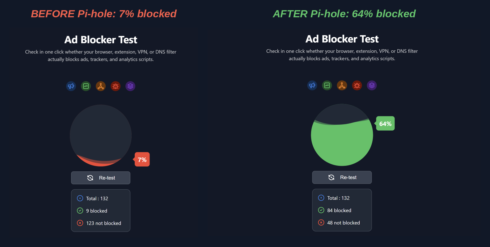

# Virtualized Network-Wide Ad Blocker with Pi-hole

A home lab that runs **Pi-hole** (a DNS sinkhole) inside an Ubuntu virtual machine and forces all DNS traffic from a Windows 11 host through it. Ads, trackers and known malicious domains are blocked at the DNS layer, before they reach the browser.


## Overview

- Ubuntu VM in VirtualBox runs Pi-hole
- Windows 11 host uses the VM as its only DNS server
- Pi-hole forwards allowed queries to Cloudflare (`1.1.1.1`, DNSSEC)
- Blocked domains are answered with a sinkhole response instead of the real IP

## Tools Used

| Tool | Purpose |
|------|---------|
| Oracle VM VirtualBox | Hypervisor for the guest VM and its network adapters |
| Ubuntu Linux | Guest OS that hosts Pi-hole |
| Pi-hole | DNS sinkhole and ad blocker |
| Cloudflare DNS | Upstream resolver |
| Windows 11 | Client machine that generates the traffic |

## Network Design

The Ubuntu VM has two adapters:

- **Adapter 1, NAT:** gives the VM internet access for updates and blocklist downloads.
- **Adapter 2, Host-Only:** a private network between the host and the VM.

| Machine | Address |
|---------|---------|
| Windows 11 host | `192.168.56.1` |
| Ubuntu VM (Pi-hole) | `192.168.56.102` |

## Setup Steps

### 1. Create the VM and network

1. Install VirtualBox on the Windows host.
2. Create an Ubuntu VM with two adapters (NAT and Host-Only).
3. Give the Host-Only interface the static IP `192.168.56.102`.
4. Ping the VM from Windows to confirm connectivity (0% packet loss).

### 2. Install Pi-hole

Run the official installer on the Ubuntu VM:

```bash
curl -sSL https://install.pi-hole.net | bash
```

In the installer:

- choose the Host-Only interface (`enp0s8`)
- choose Cloudflare as the upstream provider
- save the admin password shown at the end (do not commit it to GitHub)

### 3. Fix the "Query refused" error

**Problem:** `nslookup google.com 192.168.56.102` from Windows returned `Query refused`. Pi-hole reached the server but rejected the request, because by default it only answers queries from its own local network.

**Fix:**

1. Open the dashboard at `http://192.168.56.102/admin`.
2. Go to **Settings > DNS** and switch to **Expert** mode.
3. Under the interface settings, select **Permit all origins**.
4. Save, then reload DNS on the VM:

```bash
pihole reloaddns
```

> **Security note:** "Permit all origins" is fine here because the lab sits on an isolated Host-Only network. Do not use it on a Pi-hole that is reachable from the internet, since it could become an open DNS resolver.

### 4. Clean up the upstream DNS

**Problem:** Several IPv4 and IPv6 upstream providers were selected at once, which made resolution unreliable.

**Fix:** In **Settings > DNS**, I disabled all providers and all IPv6 options (the lab is IPv4 only) and kept a single one: **Cloudflare (DNSSEC), IPv4**.

### 5. Point Windows at Pi-hole

**Problem:** Manual `nslookup` queries worked, but normal browsing still used the router/ISP DNS, so nothing was being filtered.

**Fix:**

1. Press `Win + R`, run `ncpa.cpl`.
2. Open the properties of the active adapter.
3. Select **Internet Protocol Version 4 (TCP/IPv4)** and open Properties.
4. Set the preferred DNS server to `192.168.56.102`.

### 6. Test it

```cmd
nslookup google.com 192.168.56.102
```

The server shows up as `pi.hole` and Google's records resolve with no errors. The dashboard then shows the Windows host (`192.168.56.1`) as an active client.

## Results

### Before and after

I ran the same online ad blocker test (132 test domains) before and after switching Windows to use Pi-hole as its DNS server.



| | Blocked | Not blocked | Score |
|---|---------|-------------|-------|
| Before Pi-hole | 9 | 123 | 7% |
| After Pi-hole | 84 | 48 | 64% |

Pi-hole only filters at the DNS level, so it cannot block ads served from the same domain as the content (for example some video ads). That is why the score is not 100%. A browser extension on top of Pi-hole would catch more.

### Pi-hole dashboard

From the dashboard after testing:

| Metric | Value |
|--------|-------|
| Total queries | 1,859 |
| Queries blocked | 322 |
| Percentage blocked | 17.3% |
| Domains on blocklists | 77,759 |

Upstream traffic went to `one.one.one.one` (Cloudflare), and many queries were answered from the cache or the blocklist.

## What I Learned

- How a DNS sinkhole filters traffic without installing anything on the client
- How VirtualBox NAT and Host-Only adapters work together
- Why Pi-hole refuses queries from other subnets by default, and the risk of opening it up
- How to troubleshoot DNS step by step with `nslookup` and the query log

## Possible Next Steps

- Add extra blocklists and test their effect
- Set up a local DNS-over-HTTPS upstream (for example with `cloudflared`)
- Try the same setup on a Raspberry Pi
- Create client groups with different filtering rules

## Repository Structure

```
.
├── README.md
└── docs/
    └── images/
        ├── dashboard.png
        └── before-after.png
```
